<div align="center">

<picture>
  <source media="(prefers-color-scheme: dark)" srcset="assets/branding/svg/zpdf-studio-yatay-dark.svg">
  
</picture>

### Design PDF forms inside SAP GUI. Print them with pure ABAP.

No Adobe Document Services. No Smart Forms. No external service.

[](LICENSE)
[](#requirements)
[](#requirements)
[](https://abapgit.org)
[](designer/dist/designer.html)
[](#quality)

[Features](#features) ·
[Screenshots](#screenshots) ·
[Installation](#installation) ·
[Print from ABAP](#print-a-form-from-abap) ·
[Demo forms](#demo-forms) ·
[Documentation](#documentation)

<br>

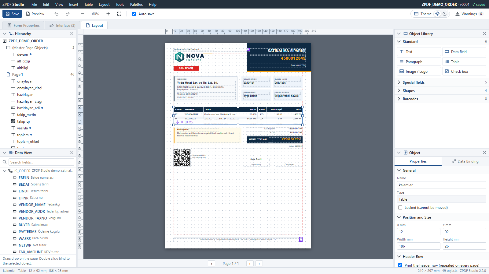

</div>

<br>

## Why ZPDF Studio

Building a PDF output in SAP usually means an Adobe Document Services license, a Smart Forms layout that nobody likes to touch, or a call to an outside service. **ZPDF Studio** takes a different path:

- 🎨 **A real designer inside SAP GUI.** Drag objects onto the page, bind them to DDIC fields, preview the real PDF, all without leaving the transaction. It works like SFP: enter a form name, press *Create*, *Change* or *Display*.
- ⚙️ **A PDF engine written in ABAP.** Text, tables that flow across pages, images, TrueType fonts, nine barcode types and Turkish / German / English formatting are produced by ABAP code on your application server.
- 🚚 **Everything is an SAP object.** Forms, versions, logos and fonts live in tables and travel with normal transport requests.

## Features

<table>
<tr>
<td width="50%" valign="top">

#### 🖱️ Visual designer
- 23 objects: text, data fields, paragraphs, tables, images, check boxes, shapes, page numbers, watermarks
- Drag & drop, snap to grid and to objects, rulers, zoom 25–400 %
- Align objects **and** align text, distribute, same size, z-order, lock
- 100-step undo / redo, cut / copy / paste, context menu
- Light and dark theme, remembered per user
- Several design pages per form; master-page objects (every page, first, last, odd, even ...)

</td>
<td width="50%" valign="top">

#### 🔗 Data binding
- Form interface made of real DDIC types: structures, table types, transparent tables / views, data elements
- Built-in DDIC search (name, package, object type, wildcards)
- Bind fields with a click or by dragging a table node onto the page: columns are created for you
- Conditions: print only when a field is filled (or empty)
- Preview data as JSON, generated from the interface
- Ready-to-paste ABAP call code for every form

</td>
</tr>
<tr>
<td valign="top">

#### 📄 Pure-ABAP PDF engine
- Tables that break across pages with repeated header rows
- Objects below a table follow its end and move to the next page if needed
- PNG (incl. transparency) and JPEG images, embedded TrueType fonts
- **Barcodes:** QR Code, DataMatrix, Code 128, Code 39, EAN-13, EAN-8, UPC-A, ITF-14
- Formats: dates, numbers, amounts in words (`WORDS:TRY`), upper / title case with Turkish i/İ rules
- Rotation, opacity, watermarks, `{currentPage}` / `{totalPages}`

</td>
<td valign="top">

#### 🏢 Built for SAP landscapes
- Versions (last 20) with *revert to this version*
- Auto-save drafts, restored on the next start
- Edit lock: a second user opens the form read-only
- Transport form **with its logos and fonts** in one step
- Logo / font repository with ALV list, preview, upload and download
- Authorization groups for editing and deleting
- Turkish logon → Turkish UI; every other language → English

</td>
</tr>
</table>

## Screenshots

<table>
<tr>
<td width="50%">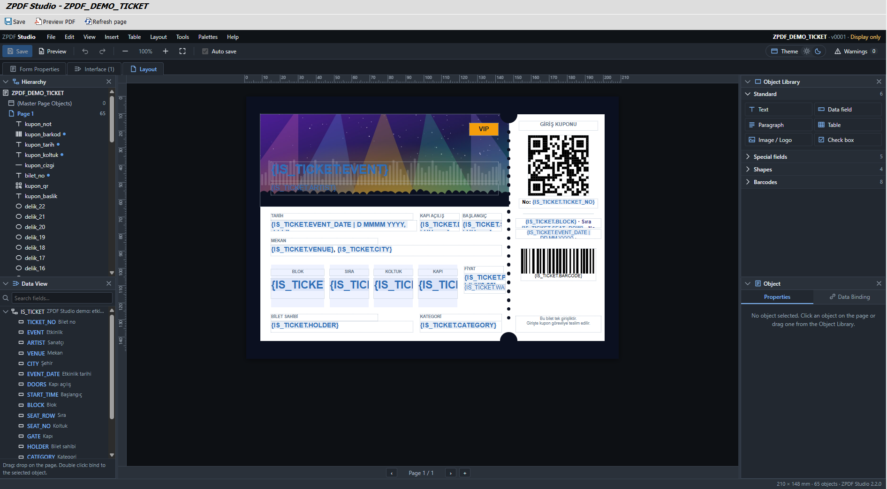<p align="center"><sub><b>In SAP GUI</b> · dark theme, display mode</sub></p></td>
<td width="50%"><p align="center"><sub><b>The printed PDF</b> · rendered by the ABAP engine</sub></p></td>
</tr>
<tr>
<td>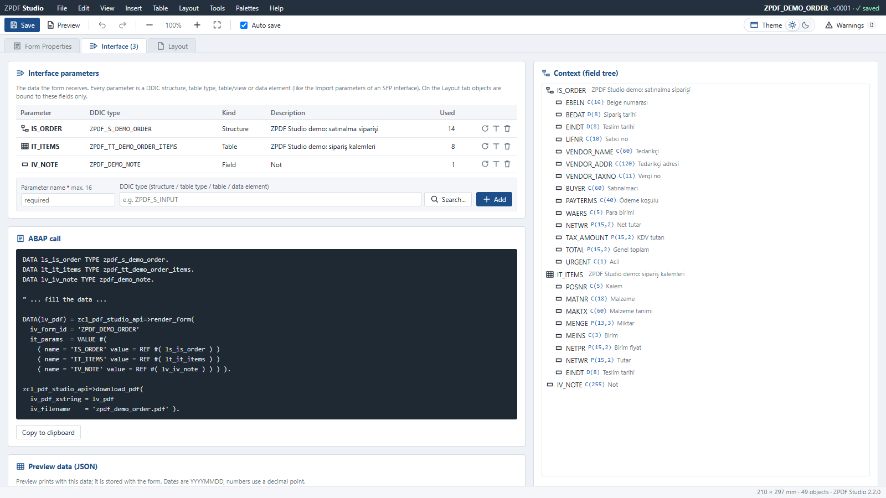<p align="center"><sub><b>Interface</b> · DDIC parameters, field tree, preview data</sub></p></td>
<td>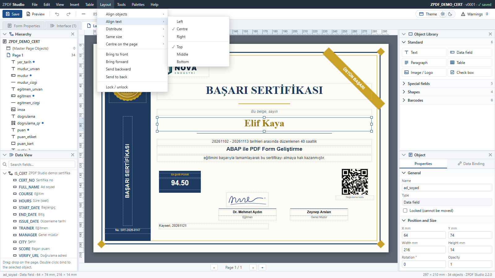<p align="center"><sub><b>Layout menu</b> · align objects vs. align text</sub></p></td>
</tr>
<tr>
<td colspan="2">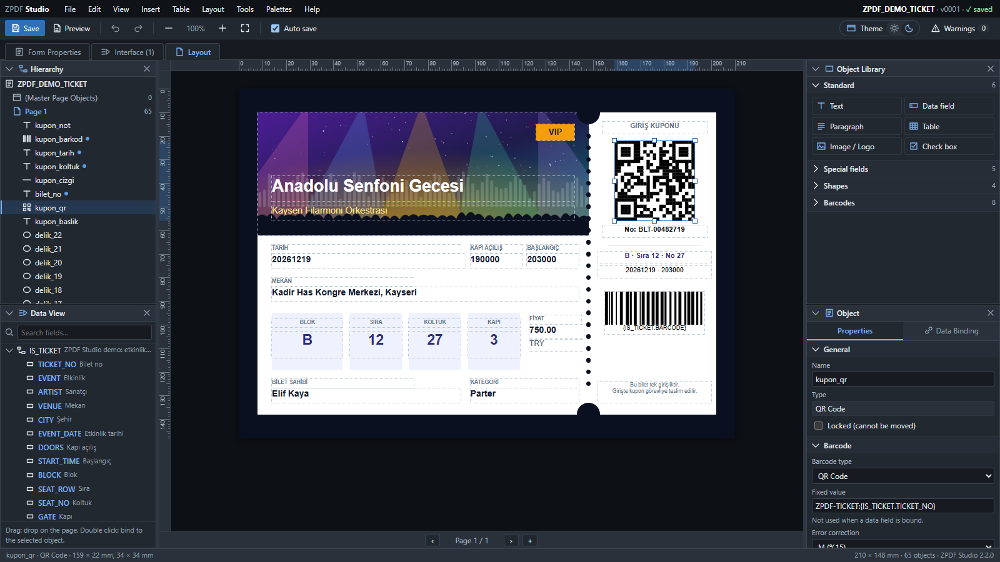<p align="center"><sub><b>Dark theme</b> · the paper stays white</sub></p></td>
</tr>
</table>

## Requirements

| | Minimum | Tested on |
| --- | --- | --- |
| **SAP system** | SAP NetWeaver / S/4HANA with ABAP 7.50 syntax | S/4HANA 2021 · SAP_BASIS 7.56 |
| **SAP GUI** | SAP GUI for Windows 7.70 with the **Edge (WebView2)** browser control | SAP GUI for Windows, Edge control |
| **Installer** | [abapGit](https://abapgit.org) (standalone or developer edition) | abapGit standalone |
| **Authorization** | `S_PROGRAM` · `P_ACTION = SUBMIT` · `P_GROUP = ZPDFSEDT` (edit) / `ZPDFSADM` (delete) | |

> [!NOTE]
> The browser control is set in *SAP GUI Options › Interaction Design › Browser Control*. The designer does not run in SAP GUI for HTML or SAP GUI for Java.

## Installation

ZPDF Studio is installed with **[abapGit](https://abapgit.org)**. One pull brings every ABAP object, the DDIC types, the designer page (MIME repository) and the GUI status of the designer.

1. **Create a package**, for example `$ZPDF_STUDIO` (local) or `ZPDF_STUDIO` (transportable).
2. **Clone with abapGit**
   - *Online:* abapGit › **New Online** › URL `https://github.com/abdullahatan/zpdf-studio` › your package › **Pull**.
   - *Offline* (no internet on the SAP server): download this repository as ZIP (**Code › Download ZIP**), then abapGit › **New Offline** › your package › **Import ZIP**.
3. **Activate** all objects when abapGit asks.
4. **Open the designer:** start program `ZPDF_STUDIO`, enter a form name and press **Create**. The status bar shows **ZPDF Studio 2.2.0**.
5. *(Optional)* **Install the demo forms:** program `ZPDF_STUDIO_DEMO` › **Install / update demo forms** › select [`designer/dist/zpdf-demo-pack.txt`](designer/dist/zpdf-demo-pack.txt).

> [!TIP]
> If `ZPDF_STUDIO` reports that the designer page is missing or outdated, press **Install / update designer** on its toolbar and select [`designer/dist/designer.html`](designer/dist/designer.html) from this repository. Forms and settings are not touched.

**Updating** is the same pull again. Your forms, versions, drafts and logos are stored in tables and are kept.

## Print a form from ABAP

Every form has an interface (like an SFP interface). Pass each parameter by name as a data reference and get the PDF back as `XSTRING`:

```abap
DATA ls_order  TYPE zpdf_s_demo_order.          " structure
DATA lt_items  TYPE zpdf_tt_demo_order_items.   " table type
DATA lv_note   TYPE zpdf_demo_note.             " data element

" ... fill the data ...

TRY.
    DATA(lv_pdf) = zcl_pdf_studio_api=>render_form(
      iv_form_id = 'ZPDF_DEMO_ORDER'
      it_params  = VALUE #( ( name = `IS_ORDER` value = REF #( ls_order ) )
                            ( name = `IT_ITEMS` value = REF #( lt_items ) )
                            ( name = `IV_NOTE`  value = REF #( lv_note ) ) ) ).

    zcl_pdf_studio_api=>download_pdf( iv_pdf_xstring = lv_pdf
                                      iv_filename    = `order.pdf`
                                      iv_open        = abap_true
                                      iv_dialog      = abap_false ).
  CATCH zcx_pdf_studio INTO DATA(lx_pdf).
    MESSAGE lx_pdf->get_text( ) TYPE 'S' DISPLAY LIKE 'E'.
ENDTRY.
```

| Method | Use it for |
| --- | --- |
| `RENDER_FORM` | Forms with an interface: one or more parameters (structure, table type, data element). Missing parameters print empty. |
| `RENDER_PDF` | Forms whose data is a single structure. |
| `DOWNLOAD_PDF` | Save the PDF on the PC: with a save dialog or into the desktop folder, and open it. |
| `SEND_MAIL` | Send the PDF as an e-mail attachment through SAPconnect. |

- The **active version** of the form is printed; page size and margins come from the form.
- `IV_LANG` (default: logon language) controls month / day names, amounts in words and case rules.
- The designer shows the exact call for each form under *Tools › ABAP call code*. Program `ZPDF_STUDIO_DEMO` has one working `PRINT_*` method per demo form.

## Demo forms

Program `ZPDF_STUDIO_DEMO` works like SAP's `DEMO*` programs: pick a form with a radio button, then open the PDF, save it, or open the form in the designer. The demo interfaces use real DDIC objects that come with the package (`ZPDF_S_DEMO_*`, `ZPDF_TT_DEMO_*`, `ZPDF_DEMO_*`).

<table>
<tr>
<td align="center" width="33%">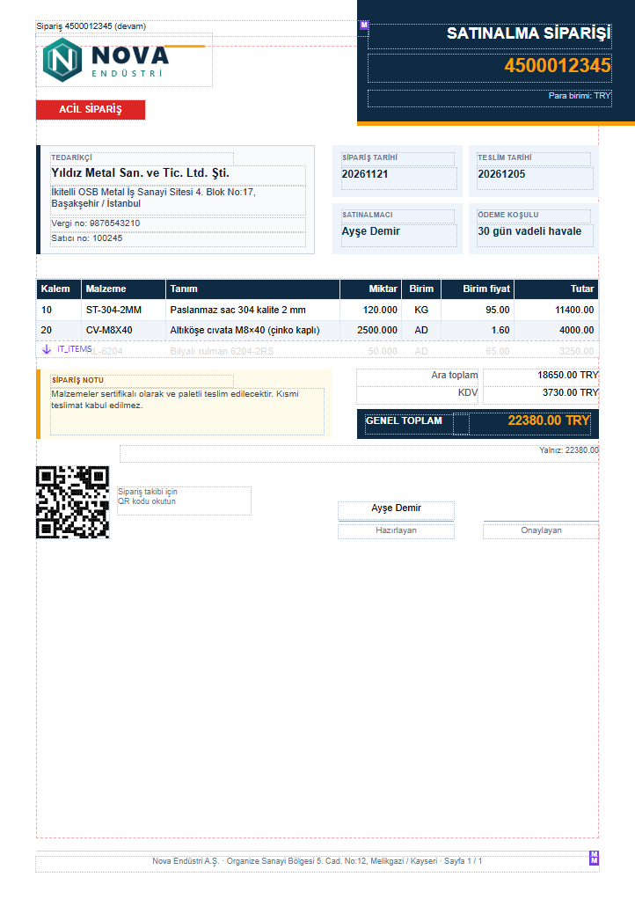<br><sub><b>Purchase order</b><br>structure + table type + data element</sub></td>
<td align="center" width="33%">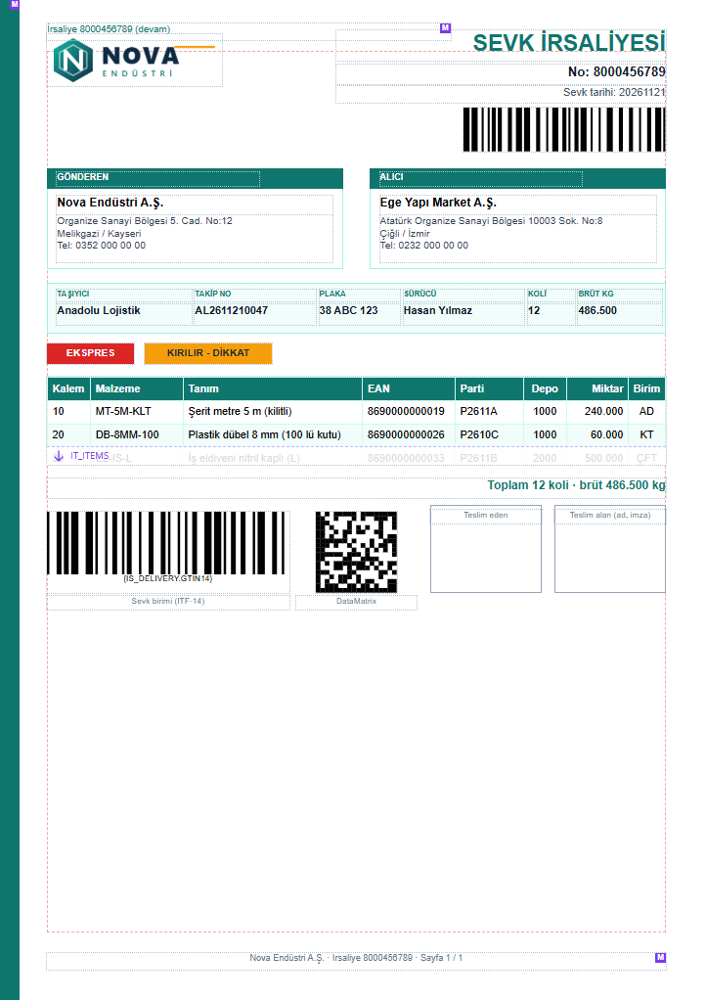<br><sub><b>Delivery note</b><br>master-page band, long table, Code 128 / ITF-14</sub></td>
<td align="center" width="33%">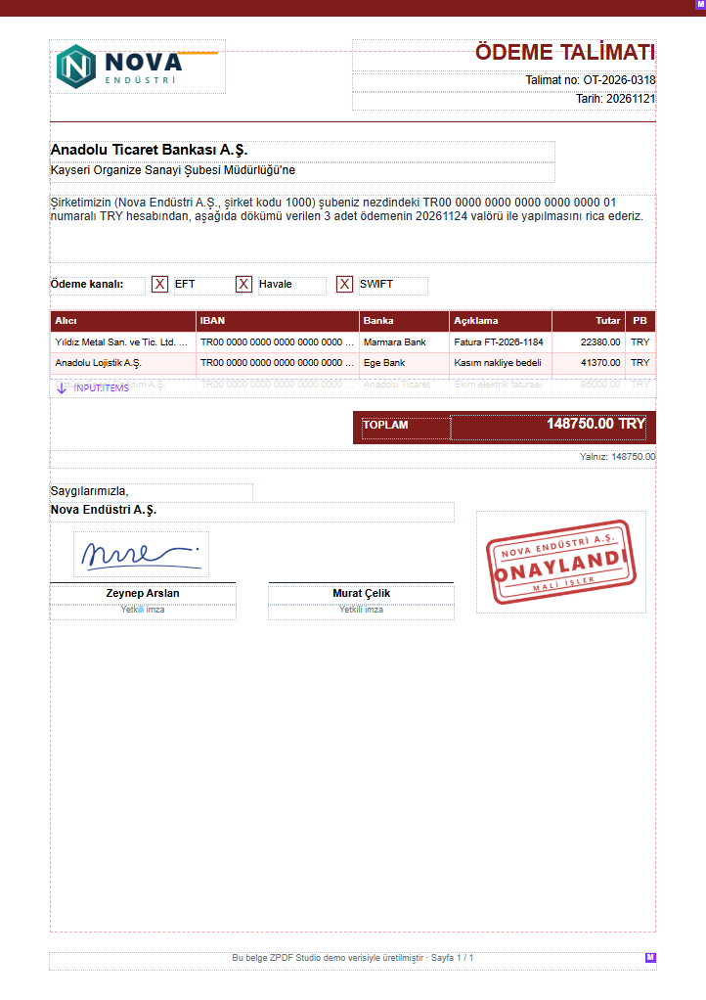<br><sub><b>Payment order</b><br>table inside a structure, check boxes, signature</sub></td>
</tr>
<tr>
<td align="center" colspan="2">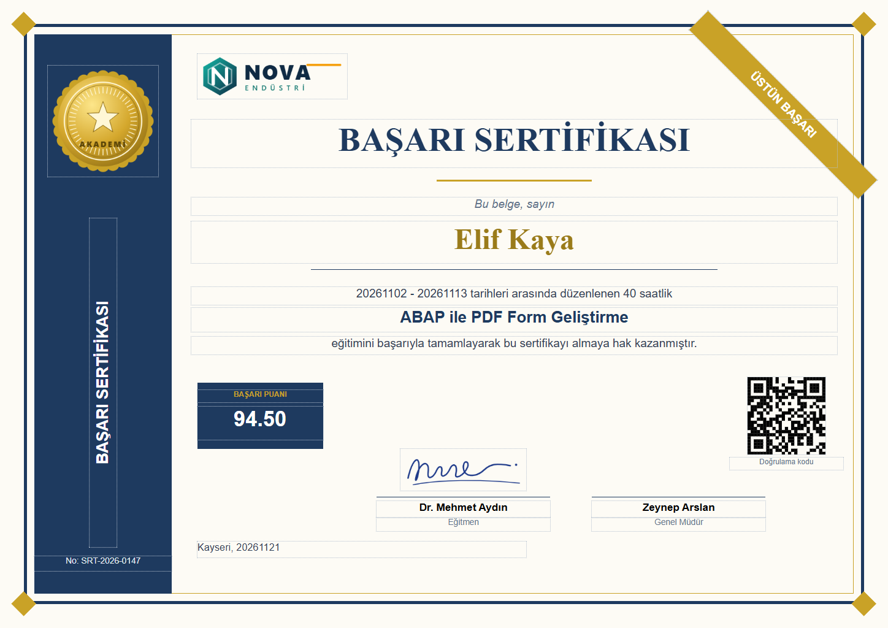<br><sub><b>Certificate</b> · A4 landscape, rotated text, seal, conditional ribbon</sub></td>
<td align="center">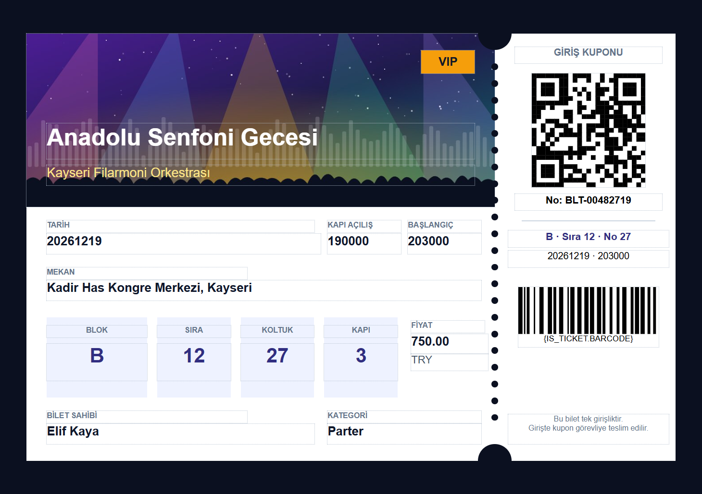<br><sub><b>Event ticket</b> · A5, photo background, QR + Code 128</sub></td>
</tr>
</table>

The sixth demo, **`ZPDF_STUDIO_INVOICE`**, is created automatically on first run: a multi-page invoice with amount in words, a conditional DRAFT watermark, DataMatrix, EAN-13 and QR.

## How it works

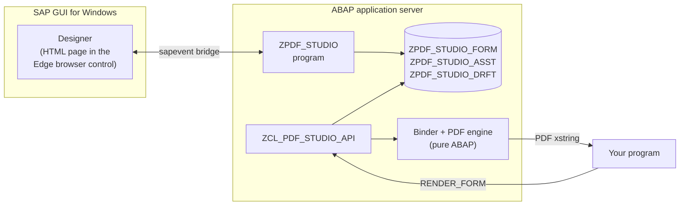

The designer is a single, self-contained HTML page stored in the MIME repository. It talks to the ABAP program through SAP GUI events and saves the form as HTML with embedded layout metadata. At print time the binder fills that template with your data and the engine writes the PDF.

## Documentation

| | |
| --- | --- |
| 📘 **[User Guide (English)](docs/USER_GUIDE_EN.md)** | Installation, every menu item, data binding, formats, repository, transport, troubleshooting |
| 📗 **[Kullanım Kılavuzu (Türkçe)](docs/USER_GUIDE_TR.md)** | Aynı içerik, Türkçe |

## Repository layout

```text
.
├── .abapgit.xml            abapGit settings (STARTING_FOLDER /src/)
├── src/                    ABAP objects: classes, programs, tables, DDIC demo types, MIME designer page
├── designer/
│   ├── src/                designer source (vanilla JavaScript + CSS)
│   ├── build.mjs           bundles src/ into dist/designer.html
│   ├── dist/
│   │   ├── designer.html       the designer page (also inside src/ as MIME object)
│   │   └── zpdf-demo-pack.txt  five demo forms + images for ZPDF_STUDIO_DEMO
│   ├── demo/               demo form definitions and pack builder
│   └── test/               conversion, UI and menu tests
├── docs/                   user guides, screenshots, menu test report
└── assets/branding/        logo and icon (SVG / PNG)
```

## Building the designer

Only needed if you change the designer itself. Requires Node.js 18+.

```bash
cd designer
npm install          # puppeteer-core, used by the UI tests only
npm run build        # -> dist/designer.html
npm test             # conversion tests
npm run demo         # -> dist/zpdf-demo-pack.txt
```

The UI tests (`npm run test:ui`) drive a local Chrome; set `CHROME` to its path if it is not in the default location. Upload the new `dist/designer.html` with **Install / update designer** in `ZPDF_STUDIO`, or replace the MIME object in `src/` and pull.

## Quality

Every feature described in the user guides was tested before release:

| Test suite | Checks | Result |
| --- | ---: | :---: |
| Menu test: each of the 103 menu items clicked for real | 177 | ✅ |
| Browser test: binding, drag & drop, zoom, theme, save | 69 | ✅ |
| Conversion test: design → engine HTML | 13 | ✅ |
| ABAP Unit: engine, formats, barcodes, JSON, text alignment in the PDF, demo forms | 59 | ✅ |

Line-by-line menu results: [`docs/test-report/menus-report.json`](docs/test-report/menus-report.json).

## License

[MIT](LICENSE). The PDF engine is derived from the abapPDF engine (MIT).

<div align="center">
<br>

<br>
<sub>Made for ABAP developers who would rather design than fight with output management.</sub>
</div>
